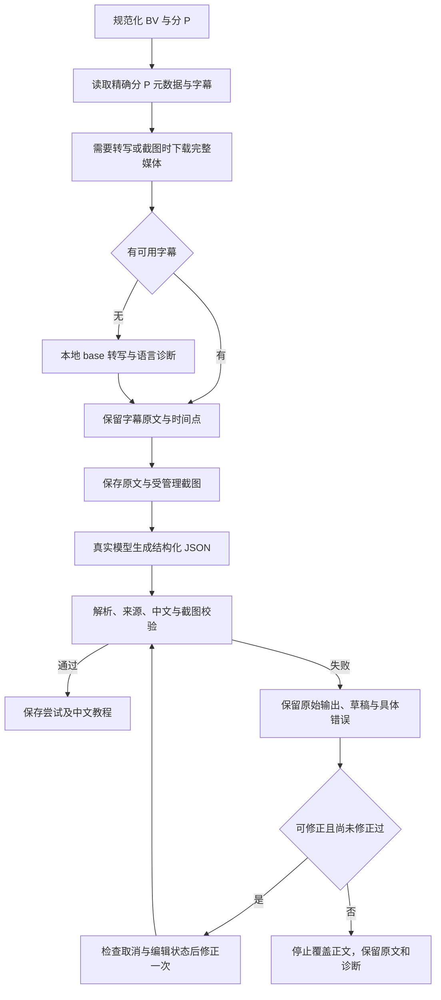

# 固定 20 条 B 站视频验收与错误分析

## 验收口径

测试集在生成前冻结，共 20 条链接、9 个 BV、合计 12,769 秒，包含用户原始的 P21、P24、P27、P28、P29。输入 SHA256 为 `e952f9111592efcd22bbec2c05d4082bcfece1e2ab092fa5a18f4e417e7916ba`，见 `artifacts/acceptance20-20261025/dataset.json`。失败样本不替换，不拼接不同轮次的成功结果。

最终验收必须由同一候选发行物重新导入全部 20 条，使用真实模型，保存中文正文、合法来源和截图。程序内部有界传输恢复与模型修正分别计数；不能把手动重跑称为一次通过。最终 round-09 已完成：同一发行物、同一模型、同一固定输入连续导入，20/20 教程在同一轮完成；手动重试为 0。首轮模型输出通过 20/20，自动修正 0 条。逐条检查来源、版本快照、中文正文、完整媒体、截图导出及真实应用重开后的渲染。验证证据为该轮 `verification.json` 和 `application-audit.json`。

## 当前工作链路

模型只选择证据，程序生成正式引用语法。下载完整性失败发生在保存原文之前；模型 JSON/引用失败发生在原文已保存之后，两类错误不能混为一谈。队列和模型运行期间由主进程维持应用级防挂起保护。

验收按用户要求的自动修正流程计：同一轮20个新导入任务全部自动完成、零手动重试；首轮模型输出通过率及有界自动修正次数单列，不把修正成功说成首轮输出就正确。修正只允许同一run_id下最多第二次生成，原错误与草稿必须保留；来源、中文、截图和完整文件的检查不放宽。

## 已确认的故障边界

1. **引用协议，而非视频不存在。** P27 自然生成把真实截图 UUID 写成原文来源，P29 把时间戳追加在真实原文 UUID 内。硬校验拒绝保存是正确行为；任意换成“存在的 ID”会破坏事实出处。
2. **语音识别质量。** tiny 会把 component level evals 听成 emails；base 的局部重听能改善，但全片语境下仍可能误识别。有效来源表示出处可追溯，不证明原始转写和教程每句话都正确。
3. **页面提取失败。** yt-dlp 的 initial-state 提取可能失败，匿名公开接口可识别原始 BV 与指定 cid，并获取完整媒体。这是平台获取层的兼容问题。
4. **下载不完整与 CDN 差异。** 早期轮次出现提前 EOF；round-03 case08 的对照探测显示同一媒体某 CDN 完整 GET 返回 HTTP 567，另一 CDN 成功下载全部 5,790,337 字节。两者小范围 Range 请求均曾成功，因此仅测响应头或 64 KiB 不能证明完整下载可用。服务端内部为何返回 567 尚不能从客户端证据确定。
5. **Windows 自动待机。** round-01 的系统事件 506/507 记录实际 Modern Standby，时间跨越模型请求。程序需要在后台队列和模型任务期间持有应用级防挂起保护。

6. **模型响应格式。** round-04 case07 的下载和 base 转写成功，但模型回答未通过 JSON 解析；旧代码未保存这个失败响应，不能确定它是截断、转义错误还是其他语法问题。原请求仅有提示词约束，未启用服务商 JSON 模式。候选 5 对明确支持的 TokenHub DeepSeek 模型启用 JSON 模式及显式 16,384 token 上限，并将坏 JSON、结束原因与解析位置作为生成失败记录保留。达到输出上限时即使片段可解析，也不当作完整结果保存；仍只允许一次有界修正。相同 VSCode 原文与 6 张截图在隔离副本上首次真实生成通过，属于定点复核，不计入完整 20 条。依据：[腾讯云 JSON 模式](https://cloud.tencent.com/document/product/1823/132248)。

7. **大文件整体重下丢失进度。** round-05 case15 的 91,426,991 字节媒体三次传输分别提前结束于 19,377,642 字节、返回 HTTP 567、提前结束于 48,496,106 字节；并未达到总超时，而是在完整体重试中丢失已收数据后耗尽次数。case16 同样在下载层失败。候选 6 因此增加严格分段，而非仅延长重试时间。首个分段定点测试在 14 MiB 检出版本标识不一致并安全拒绝拼接；后续候选支持清空前缀后重新选择表示。

## 已实现的改动

候选7对模型连接中断、429及特定5xx提供最多三次请求，共享原有240秒预算；401/403、参数错误和证书问题不重试。Retry-After等待分段检查取消。记录请求次数、固定错误类别、状态码和已收字节，不保存密钥、响应头或原始异常。最终请求失败也保留生成记录；连接恢复次数与内容自动修正分别披露。网络失败不能证明服务端未执行，重发可能产生额外用量。

模型输出结构化 sections，分别选择 S 原文与 F 截图；程序渲染真实 UUID、标记外时间点与受管理图片链接。每个事实分节必须有有效原文来源，AI 补充显式标注，未知 ID、截图充当原文以及任意图片标签均拒绝。原始来源 ID、文本、顺序、时间点和版本快照保持不变。

生成尝试独立保存 raw_result、草稿和具体错误；校验失败允许自动修正一次，再做完整校验。失败和取消不覆盖成功正文；取消及并发编辑保护保持有效。

转写默认 base，可选择 tiny/base/small，不静默降级，并持久保存实际模型、语言与分段诊断。下载检查元数据长度、响应长度和实际字节数。小文件保留完整 GET；大于 2 MiB 的已知大小文件使用 2 MiB 顺序分段，精确校验 206 范围、完整总长、响应长度及实际字节后才提交。相同 URI 上坏段可重试，已验证前缀保留；切换 CDN 或版本标识变化时从零开始，绝不混合未确认表示。强 ETag 使用 If-Range；200 忽略范围时清空前缀并从零回退完整 GET。全片采用大小感知的 600–1800 秒总预算，每段最多三次请求并设全局请求上限；预算和计数跨重试持续累计。不用备用接口绕过 401/403，不接受部分视频冒充完整视频。

Electron 主进程在长请求和后台队列期间持有 prevent-app-suspension，结束后释放；不修改系统电源计划。权威队列计数独立于最多 200 条历史列表，防止隐藏的旧任务被误认为已结束；异步观察有版本保护，防止旧空闲结果释放新任务的保护。

## 已完成的本地回归

候选8：239项Python测试通过；桌面代码未变，沿用已通过的17项Node测试。新增6项模型传输测试与取消等待修复通过独立复核。PyInstaller 后端和 Electron 发行目录构建通过。三项打包应用冒烟通过：结构化证据渲染与持久化、错误草稿与自动修正、媒体导入与中文校验/图片导出。冒烟使用可控本地模型响应，不代表真实 20 条视频验收。

## 历史轮次保留

- round-01：14 条教程完成、5 条失败、1 条在候选更换时取消；包含下载故障及实际系统待机。
- round-02：前 5 条完成，发现并修复防挂起观察竞争后取消余下 15 条。
- round-03：8 条完成、6 条下载失败、6 条在更换候选时取消。所有已完成教程均首次生成通过。原观察脚本完成记录后调用了 preload 未暴露的 media_activity，额外后检查报错；这是观察脚本问题，不能掩盖原本存在的 6 条下载失败。后续脚本改用公开 bootstrap.media_active。
- round-04：9 条首次完成、1 条模型 JSON 解析失败、10 条更换候选时取消。整轮未通过，结果保留。
- round-05：18 条自动完成（首轮模型 17 条、自动修正 1 条），2 条大文件下载失败，0 条取消；整轮未通过。
- round-06：19条完成、1条模型连接失败；两条此前失败的大视频均完整下载。第16条在调用模型约12秒后连接失败，旧代码未保留底层异常，不能进一步断定DNS、重置或其他原因；整轮未通过。
- round-07：前5条完成，第6条转写中记录中断，原进程已不存在，无整轮结束证据；未计为通过，确切终止原因未确定。
- round-08：8条完成、1条下载失败、11条候选更换时取消。case07为14,977,135字节，低于原16MiB门槛，整文件下载先HTTP567，再4,832,374字节提前结束，最后连接失败；整轮未通过。
- round-09：完整 20 条验收，20 条全部自动完成；首轮模型通过 20/20，自动修正 0 条。

## 部署复核说明

第9轮20/20及实际界面检查通过后，首次部署复制遇到手动打开候选产生的运行资料目录锁；该目录并非发行程序。保留原失败日志及首次程序/数据库备份，部署工具改为排除候选旁的data目录后继续后检查，未重跑任何原生生成任务。误复制到目标下的空运行目录单独移存，不删除；用户打开的候选窗口和资料未关闭或覆盖。后续以delivery-recovery.json记录安装冒烟及正式资料库复核结果。

## 工具选型与尚未实施的质量增强

faster-whisper 已使用并增加模型选择。FFmpeg 已负责媒体探测和截图。按需截图/裁剪、PaddleOCR、局部重新听写和短片段视频理解适合进一步核对菜单、参数、术语；目前未宣称已接入模型工具循环。Bilibili MCP 可补充字幕查询与章节，不能直接修复知序内部的来源协议。BiliNote 的真实分发代码经 REA 与字节码对照，生成普通 Markdown/时间标记，与知序严格 UUID 引用校验不是同一验收条件；此前只读证据见 `artifacts/acceptance-bili-20261025/bilinote-analysis.md`。

## 本轮逐条结果

| 编号 | 视频 | 时长 | 原文片段 | 中文字 | 引用 | 下载恢复 | 结果 |
|---|---|---:|---:|---:|---:|---:|---|
| bili20-01 | [3-更多误差分析示例](https://www.bilibili.com/video/BV1AJen6SEVQ/?p=21) | 316s | 56 | 1487 | 65 | 0 | 首次生成通过 |
| bili20-02 | [6-延迟、成本优化](https://www.bilibili.com/video/BV1AJen6SEVQ/?p=24) | 247s | 43 | 1671 | 51 | 0 | 首次生成通过 |
| bili20-03 | [2-创建和执行LLM计划](https://www.bilibili.com/video/BV1AJen6SEVQ/?p=27) | 160s | 28 | 818 | 31 | 0 | 首次生成通过 |
| bili20-04 | [3-结合代码执行的规划](https://www.bilibili.com/video/BV1AJen6SEVQ/?p=28) | 432s | 49 | 1764 | 49 | 0 | 首次生成通过 |
| bili20-05 | [4-多智能体工作流](https://www.bilibili.com/video/BV1AJen6SEVQ/?p=29) | 546s | 125 | 1965 | 134 | 0 | 首次生成通过 |
| bili20-06 | [009_HTML初体验](https://www.bilibili.com/video/BV1p84y1P7Z5/?p=9) | 591s | 377 | 1666 | 108 | 0 | 首次生成通过 |
| bili20-07 | [013_安装VSCode](https://www.bilibili.com/video/BV1p84y1P7Z5/?p=13) | 1419s | 918 | 2270 | 297 | 0 | 首次生成通过 |
| bili20-08 | [010_HTML标签](https://www.bilibili.com/video/BV1p84y1P7Z5/?p=10) | 553s | 340 | 2503 | 305 | 0 | 首次生成通过 |
| bili20-09 | [010_入门前的准备-VSCode安装open in browser](https://www.bilibili.com/video/BV1HU4y1J7R2/?p=10) | 341s | 73 | 726 | 52 | 0 | 首次生成通过 |
| bili20-10 | [011_入门前的准备-使用VSCode创建和删除文件](https://www.bilibili.com/video/BV1HU4y1J7R2/?p=11) | 246s | 58 | 877 | 12 | 0 | 首次生成通过 |
| bili20-11 | [全B站最傻瓜的Git入门精讲课](https://www.bilibili.com/video/BV1WH4y1H7zV/?p=1) | 1796s | 1207 | 1907 | 164 | 1 | 首次生成通过 |
| bili20-12 | [用Python设计第一个游戏](https://www.bilibili.com/video/BV1c4411e77t/?p=3) | 488s | 255 | 916 | 57 | 0 | 首次生成通过 |
| bili20-13 | [变量和字符串（上）](https://www.bilibili.com/video/BV1c4411e77t/?p=4) | 703s | 428 | 2216 | 161 | 3 | 首次生成通过 |
| bili20-14 | [关系型数据库](https://www.bilibili.com/video/BV1iJ41137Vd/?p=1) | 488s | 123 | 1005 | 122 | 0 | 首次生成通过 |
| bili20-15 | [3. 布尔逻辑 和 逻辑门-Boolean Logic & Logic Gates](https://www.bilibili.com/video/BV1EW411u7th/?p=3) | 607s | 250 | 2592 | 237 | 5 | 首次生成通过 |
| bili20-16 | [12. 编程原理-语句和函数-Programming Basics - Statements & Functions](https://www.bilibili.com/video/BV1EW411u7th/?p=12) | 717s | 226 | 2407 | 219 | 5 | 首次生成通过 |
| bili20-17 | [【第二章】1- 选择语句 / The SELECT Statement「在单一表格中检索数据」](https://www.bilibili.com/video/BV1UE41147KC/?p=7) | 351s | 82 | 1215 | 99 | 0 | 首次生成通过 |
| bili20-18 | [【第三章】1- 内连接 / Inner Joins「在多张表格中检索数据」](https://www.bilibili.com/video/BV1UE41147KC/?p=18) | 508s | 112 | 1320 | 123 | 0 | 首次生成通过 |
| bili20-19 | [10-ubuntu基本使用](https://www.bilibili.com/video/BV1P7411b7bm/?p=9) | 540s | 449 | 991 | 23 | 0 | 首次生成通过 |
| bili20-20 | [11-Linux基本命令-1](https://www.bilibili.com/video/BV1P7411b7bm/?p=10) | 1720s | 1193 | 1191 | 209 | 1 | 首次生成通过 |

模型 HTTP 请求共 20 次，连接恢复 0 次。首次生成通过描述收到的首个完整模型输出，不表示只发过一个 HTTP 请求；网络中断时服务端是否已执行无法由客户端确定。详细分类见 ai_request 事件及 CSV。

本轮内部下载恢复共 15 次，涉及 5 条视频；手动重试为 0。首次生成次数单独计算，未把网络恢复隐去。
- bili20-11 第 1 个传输候选：connection，已收 0 / 40655847 字节，尚未取得 HTTP 响应，分段 0–2097151、已验证前缀 0 字节；后续完整媒体和教程通过同轮独立验收。
- bili20-13 第 1 个传输候选：early_eof，已收 704028 / 27657141 字节，HTTP 206，分段 0–2097151、已验证前缀 0 字节；后续完整媒体和教程通过同轮独立验收。
- bili20-13 第 1 个传输候选：early_eof，已收 704028 / 27657141 字节，HTTP 206，分段 0–2097151、已验证前缀 0 字节；后续完整媒体和教程通过同轮独立验收。
- bili20-13 第 1 个传输候选：early_eof，已收 704028 / 27657141 字节，HTTP 206，分段 0–2097151、已验证前缀 0 字节；后续完整媒体和教程通过同轮独立验收。
- bili20-15 第 1 个传输候选：connection，已收 35651584 / 91426991 字节，尚未取得 HTTP 响应，分段 35651584–37748735、已验证前缀 35651584 字节；后续完整媒体和教程通过同轮独立验收。
- bili20-15 第 1 个传输候选：connection，已收 37748736 / 91426991 字节，尚未取得 HTTP 响应，分段 37748736–39845887、已验证前缀 37748736 字节；后续完整媒体和教程通过同轮独立验收。
- bili20-15 第 1 个传输候选：connection，已收 62914560 / 91426991 字节，尚未取得 HTTP 响应，分段 62914560–65011711、已验证前缀 62914560 字节；后续完整媒体和教程通过同轮独立验收。
- bili20-15 第 1 个传输候选：connection，已收 65011712 / 91426991 字节，尚未取得 HTTP 响应，分段 65011712–67108863、已验证前缀 65011712 字节；后续完整媒体和教程通过同轮独立验收。
- bili20-15 第 1 个传输候选：connection，已收 90177536 / 91426991 字节，尚未取得 HTTP 响应，分段 90177536–91426990、已验证前缀 90177536 字节；后续完整媒体和教程通过同轮独立验收。
- bili20-16 第 1 个传输候选：connection，已收 35651584 / 112625089 字节，尚未取得 HTTP 响应，分段 35651584–37748735、已验证前缀 35651584 字节；后续完整媒体和教程通过同轮独立验收。
- bili20-16 第 1 个传输候选：connection，已收 35651584 / 112625089 字节，尚未取得 HTTP 响应，分段 35651584–37748735、已验证前缀 35651584 字节；后续完整媒体和教程通过同轮独立验收。
- bili20-16 第 1 个传输候选：connection，已收 75497472 / 112625089 字节，尚未取得 HTTP 响应，分段 75497472–77594623、已验证前缀 75497472 字节；后续完整媒体和教程通过同轮独立验收。
- bili20-16 第 1 个传输候选：connection，已收 75497472 / 112625089 字节，尚未取得 HTTP 响应，分段 75497472–77594623、已验证前缀 75497472 字节；后续完整媒体和教程通过同轮独立验收。
- bili20-16 第 1 个传输候选：connection，已收 79691776 / 112625089 字节，尚未取得 HTTP 响应，分段 79691776–81788927、已验证前缀 79691776 字节；后续完整媒体和教程通过同轮独立验收。
- bili20-20 第 1 个传输候选：connection，已收 25165824 / 30674691 字节，尚未取得 HTTP 响应，分段 25165824–27262975、已验证前缀 25165824 字节；后续完整媒体和教程通过同轮独立验收。

## 交付

正式启动目录已更新为 D:\rea-tools\video-knowledge-desktop\release\win-unpacked，关键文件哈希与本轮测试候选一致。正式资料库未导入测试集，升级备份和哈希见 deployment.json。20 份含图片的教程见 round-09/bili20-XX-中文教程.md；CSV 提供全部链接与指标。

本次证明固定测试集在该时间、网络和模型配置下完成。下载内部恢复不等于手动重跑教程。不能将 20/20 推广为所有 B 站视频均可下载，也不代表逐句知识事实已由人工审核。

正式默认资料库已用已部署版本重新启动并关闭；资料、原文、版本、截图登记和收藏的逻辑摘要与升级前备份一致，20条测试资料未混入正式库。原有P19教程中文正文与截图也已实际重开验证，没有重新生成或改写来源。
